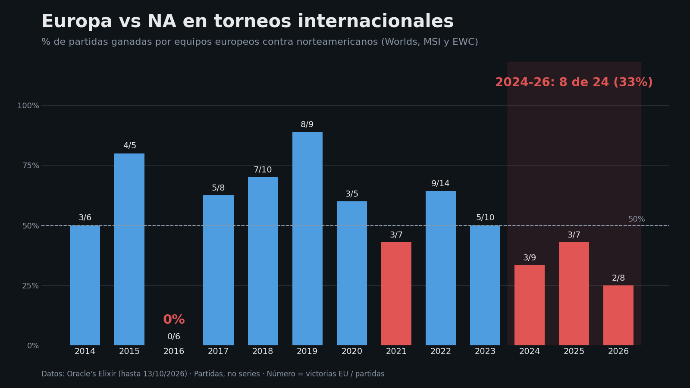
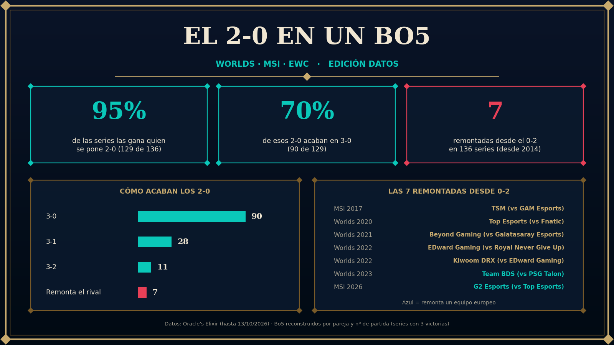
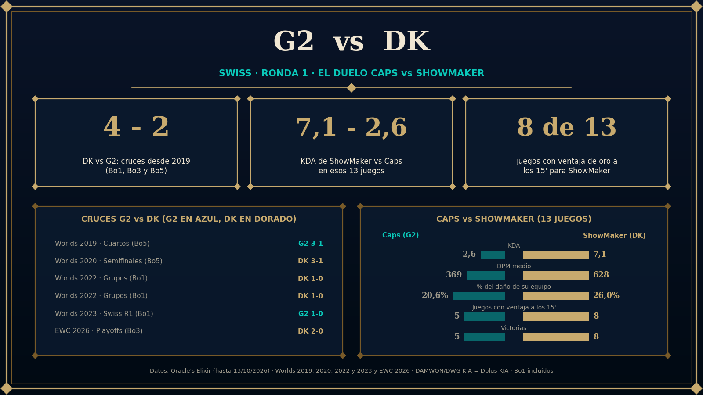
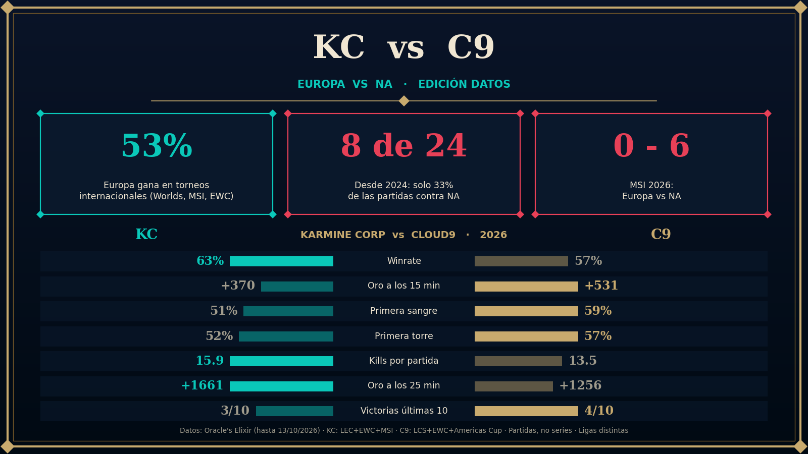

# LoL Worlds 2026 · análisis de datos

Análisis de datos de partidas profesionales de **League of Legends** para la cuenta de Twitter/X de Worlds 2026:
cruces entre regiones, series de Bo5, duelos entre jugadores... y las imágenes (estilo hextech) que acompañan cada tweet.

Hecho con **Python (pandas + matplotlib)** a partir de los CSV de [Oracle's Elixir](https://oracleselixir.com).

## Ejemplos

| | |
|---|---|
|  |  |
|  |  |

## Estructura

```
scripts/    un script por análisis (cada uno genera sus imágenes)
data/       aquí van los CSV de Oracle's Elixir (no se suben)
output/     imágenes generadas
docs/       metodología, datos añadidos a mano y correcciones
```

## Cómo usarlo

1. Descarga los CSV de Oracle's Elixir (ver [data/README.md](data/README.md)) y colócalos en `data/`.
2. Instala las dependencias: `pip install -r requirements.txt`
3. Ejecuta un script desde la raíz del repo, por ejemplo: `python scripts/swiss_r1_cards.py`

Rutas alternativas con variables de entorno: `DATA_DIR=/ruta/a/csv OUT_DIR=/ruta/imagenes python scripts/...`

## Scripts

| Script | Qué hace |
|---|---|
| `europa_vs_na_tendencia.py` | % de partidas ganadas por Europa contra NA en torneos internacionales, por año |
| `apac_vs_brasil.py` | APAC (PCS/VCS/LCP) vs Brasil: tarjeta de KPIs y gráfico por años |
| `kpi_card_kc_c9.py` | Tarjeta comparativa KC vs C9 (winrate, oro a los 15', primera sangre...) |
| `kc_vs_mvk_card.py` | Europa vs APAC: historial, por año y últimas series |
| `bo5_2_0_card.py` | ¿Cuántas veces gana la serie quien se pone 2-0 en un Bo5 internacional? |
| `swiss_r1_cards.py` | 4 tarjetas de la ronda 1 del Swiss (LCK-LPL, LPL-LEC, LCS-LCP y G2-DK/Caps-ShowMaker) |

## Metodología (resumen)

- El CSV no indica el formato de la serie: se **reconstruyen las series** por pareja de equipos y nº de partida.
- Las regiones se asignan por la **liga doméstica de cada equipo ese año**.
- Se distingue siempre entre **partidas** y **series**.
- Los datos llegan hasta el **13/10/2026**.

Detalles, limitaciones y correcciones en [docs/metodologia.md](docs/metodologia.md).

## Aviso

Proyecto de aficionado. No está afiliado ni respaldado por Riot Games ni por Oracle's Elixir.
*League of Legends* es marca de Riot Games. Los datos pertenecen a sus autores; los CSV no se redistribuyen aquí.
